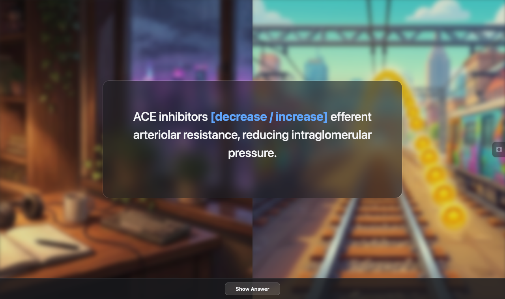
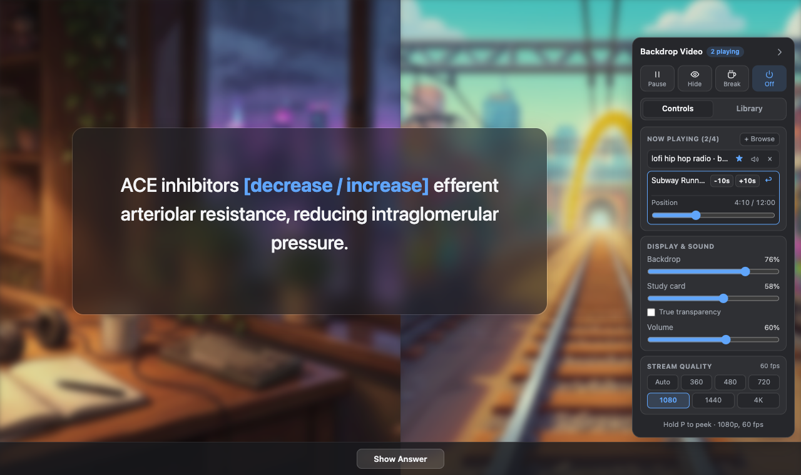

# Backdrop Video for Anki

Play a soft, blurred video or live stream behind your Anki cards while you study — instead of covering card text with a picture-in-picture window.

## Features

- **Frosted-glass card plate:** Your card stays centered and legible over moving video; compatible with stock Anki and UI/theme add-ons (Onigiri, Synapse, AMBOSS, AnKing note types). Includes a **Study card** translucency slider and a **True transparency** toggle (which also fades frosted blur, border, and shadow as you slide down).
- **Multi-view (1–4 videos or streams):** Stack up to 4 videos or live streams behind your cards (2 split evenly, 3 in a 2-top + 1-bottom layout, 4 in a 2×2 grid) with flush center alignment and zero cropping across window resizes and vertical videos. Mute, save, or remove individual streams anytime, even down to the last stream.
- **Saved folders & multi-select:** Organize videos/streams into compact folder pills right in the sidebar (`★` on active streams, recents, or inside Browse), and use **Select** to pick up to 4 saved items across folders to launch together in multi-view.
- **Right-edge quick controls:** Play/Pause, hide picture (keep sound), **Break zone** (watch clearly while pausing card & Pomodoro timers, with live break/rest countdown), **per-video timestamp scrub bar & `-10s` / `+10s` skip** (click any non-live video's title in **Now Playing**—even in 2–4 video multi-view—to open persistent skip/scrub controls, and `↩` to return to `★`/Mute/`×`), **Backdrop** strength slider, **Study card** translucency + **True transparency**, **Volume** slider, **Stream quality** (`Auto`, `360`, `480`, `720`, `1080`, `1440`, `4K`) with live FPS display, built-in tabbed **Search / Browse** pop-up (`🔍`, multiple tabs, `★ Save…`, safe `+ Add` default when playing), link paste/clipboard offer, **Saved** folders, and **Recent** links with `+` play-alongside, `★` save, and `×` delete. Auto-minimizes when clicking back into the study area and never steals keyboard focus from Space or `1`–`4`.
- **Tools → Backdrop Video… manager (`Ctrl/Cmd+Shift+B`):** Two-column organizer for **Saved Folders** (create, rename, delete, move, paste links into folders, multi-select Play/`+ Add`), quick launch to **Browse / Pre-find Videos…**, display/quality controls, and one-click `yt-dlp` live stream helper download/update.
- **Hold P to peek:** Hold **P** any time during review or deck overview to see the full video clearly; release to return to your card.
- **Audio ducking:** Automatically drops backdrop volume to 1/4 while card audio, `{{tts}}`, or [Read Aloud](https://ankiweb.net/shared/info/1227298382) is speaking.
- **Plays videos other apps can't:** YouTube videos that only play on YouTube (most music, sports and other monetized uploads) and sites that refuse to be shown inside other apps (checked from the site's `X-Frame-Options` / `frame-ancestors` headers) are played through the `yt-dlp` helper instead; YouTube links that needed it are remembered so they skip the failed attempt next time, and a page with no video gets a plain message instead of a blank backdrop. The helper question waits until the screen has drawn and downloads and plays in one click.
- **Smooth screen changes:** Switching between the deck overview and the cards keeps each video's last frame (or YouTube's preview picture) on screen until the video is back, and resumed videos start from the nearest keyframe (~1 s faster).
- **Live streams & webcams:** Supports YouTube, YouTube Live, Twitch, Kick, direct `.mp4`/`.webm`/`.m3u8`/`.mpd` links, and other `yt-dlp`-supported streams (no live chat). Regular YouTube/WebM videos stream directly; live streams and H.264/HLS feeds convert in memory via Anki's bundled `mpv` using hardware decode (`--hwdec=auto-safe`) and adaptive `30–60 fps` (configurable via `multi_fps` in add-on config), stopping immediately when paused or closed.

## Usage

1. Open **Tools → Backdrop Video…** (`Ctrl+Shift+B` on Windows/Linux, `Cmd+Shift+B` on Mac).
2. Paste a YouTube, Twitch, or video link and click **Play**.
3. Use the tab on the right edge while studying to adjust blur, volume, position, or stream quality.

## Development & Tests

- Build `.ankiaddon` packages into `dist/`: `python3 build.py`
- Run tests:
  - `python3 tests/test_source.py`
  - `QT_QPA_PLATFORM=offscreen <anki-python> tests/test_dialog.py .`
  - `QT_QPA_PLATFORM=offscreen <anki-python> tests/test_web.py`

## Bug Reports

Please open an [issue](https://github.com/wilsondong41/anki-backdrop/issues) with your OS, Anki version, the type of link (YouTube, Twitch, video URL), and any error message or theme add-on in use.

---

**COMPLETELY VIBED CODED WITH CLAUDE AI, THE GOAT.**
